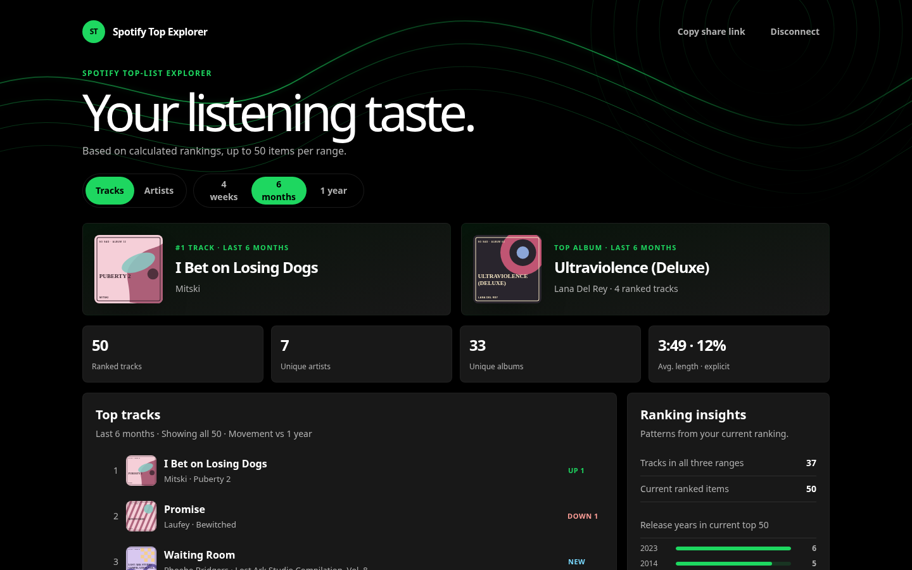
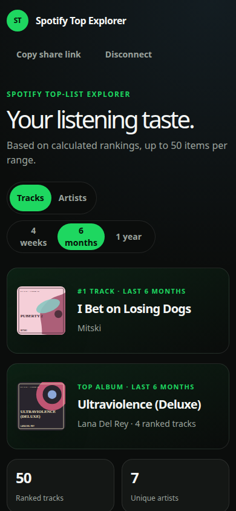

# Spotify Top Explorer

Turn your Spotify top tracks and artists into rankings you can compare,
export, and share.

Spotify Top Explorer is a static listening-insights app built with Svelte and
TypeScript. It loads all three available Spotify time ranges, shows movement
against the yearly ranking, exports CSV or JSON, and creates read-only share
links that recipients can open without Spotify access.

[](https://svelte.dev/)
[](https://www.typescriptlang.org/)
[](https://vite.dev/)
[](https://tailwindcss.com/)

> Live at
> [spotify-analyzer.tawan-jhaidee.workers.dev](https://spotify-analyzer.tawan-jhaidee.workers.dev/).

## Features

- Bring-your-own Spotify Client ID setup with no deployment required
- Optional Owner Access for approved Spotify accounts
- Spotify Authorization Code with PKCE and automatic token refresh
- Top 50 tracks and artists for 4 weeks, 6 months, and 1 year
- Six-month movement compared with the yearly track ranking
- Top-track, top-album, listening-stat, overlap, and release-year insights
- Current-ranking and complete CSV/JSON exports
- No-login sharing through compressed URL fragments
- A deterministic 50-item demo that requires no Spotify account
- Static Cloudflare Workers deployment with no backend or database

## Use your Spotify data

You need a Spotify account. You only need to do this setup once.

```text
Create a Spotify app
→ Add the redirect URI below
→ Paste its Client ID into Spotify Top Explorer
→ Connect Spotify
```

### 1. Create a Spotify app

Open the [Spotify Developer Dashboard](https://developer.spotify.com/dashboard/create)
and create an app. You can use:

```text
App name: Listening Snapshot
Description: Explore and export my Spotify top tracks and artists.
```

Select **Web API**.

Add this redirect URI exactly:

```text
https://spotify-analyzer.tawan-jhaidee.workers.dev/
```

### 2. Copy your Client ID

Open the new Spotify app, select **Settings**, and copy its **Client ID**.

The Client ID is public. Never paste a Client Secret.

### 3. Connect

Open [Spotify Top Explorer](https://spotify-analyzer.tawan-jhaidee.workers.dev/),
paste the Client ID, and select **Connect Spotify**.

Detailed implementation and UX decisions are documented in
[docs/byo-spotify-client-id.md](docs/byo-spotify-client-id.md).

### Owner Access

Owner Access uses this deployment's preconfigured Spotify Client ID. It is
hidden unless `VITE_SPOTIFY_CLIENT_ID` is configured and is limited to approved
Spotify accounts.

## Try the demo

Run the fixture-backed demo without Spotify credentials:

```bash
npm ci
npm run dev:demo
```

Open [http://127.0.0.1:8000/](http://127.0.0.1:8000/).

`npm run dev:mock` remains as a backward-compatible alias for the same
dashboard-only demo.

## Mock authentication

To exercise the real BYO and Owner Access screens without contacting Spotify:

```bash
npm run dev:mock-auth
```

Choose either connection path and provide a valid-format test Client ID. The
visitor Client ID is prefilled, and Owner Access has its own fake Client ID.
The app creates a synthetic browser-only session and opens the fixture
dashboard. No Spotify authorization or API request is made. Remember me starts
unchecked so a new tab returns to onboarding, while reloading the connected tab
keeps the test session.

## Local development

Install dependencies and start Vite:

```bash
npm ci
npm run dev
```

The bring-your-own setup works without an environment file. Add this local
redirect URI to the Spotify app you use:

```text
http://127.0.0.1:8000/callback
```

Optionally, configure Owner Access with `.env.local`:

```text
VITE_SPOTIFY_CLIENT_ID=<your-public-client-id>
VITE_SITE_URL=http://127.0.0.1:8000/
```

The Spotify Client ID is public. This project does not use a Client Secret.
Select **Owner Access** on the connection screen to use it. Use
`npm run dev:demo` for fixture data without authentication.

## How it works

```text
Spotify OAuth
  → Spotify Web API
  → normalized TypeScript models
  → rankings and dashboard insights
  → exports or compressed share links
```

Live and mock data implement the same `SpotifyClient` boundary. Svelte handles
presentation; authentication, API access, ranking calculations, exports, and
sharing remain framework-independent services.

Framework and state-boundary details are documented in
[docs/svelte-migration.md](docs/svelte-migration.md).

## Tests

```bash
npm run check
npm run test:e2e
npm run test:coverage
```

The project currently has 41 passing unit/component tests and 12 fixture-backed
Playwright journeys, including desktop and mobile visual regression checks.
Automated tests never contact Spotify.

`npm run dev:demo` opens the dashboard fixture directly and intentionally skips
Spotify authentication. `npm run dev:mock-auth` displays both authentication
paths. To exercise the real callback flow with mocked OAuth and API responses,
run:

```bash
npx playwright test e2e/oauth.spec.ts
```

### Visual regression baselines

<table>
  <tr>
    <th>Desktop</th>
    <th>Mobile</th>
  </tr>
  <tr>
    <td>
      
    </td>
    <td>
      
    </td>
  </tr>
</table>

## Production

```bash
npm run build
```

The build is deployed automatically after a push to `main` by
`.github/workflows/deploy.yml` using Wrangler. The workflow can also be started
manually from the GitHub Actions page.

Repository secrets:

```text
CLOUDFLARE_API_TOKEN
CLOUDFLARE_ACCOUNT_ID
```

Repository variables:

```text
VITE_SPOTIFY_CLIENT_ID=<public-client-id>
VITE_SITE_URL=https://your-production-domain/
```

The Cloudflare API token needs `Account > Workers Scripts > Edit` permission.
Worker name and static-asset settings live in `wrangler.jsonc`. Forks without
the required values skip deployment instead of failing the workflow.

## Privacy

Client IDs and OAuth tokens stay in the visitor's browser. Share snapshots never
include tokens or Spotify account identifiers, and personal fixtures remain
excluded from Git.
